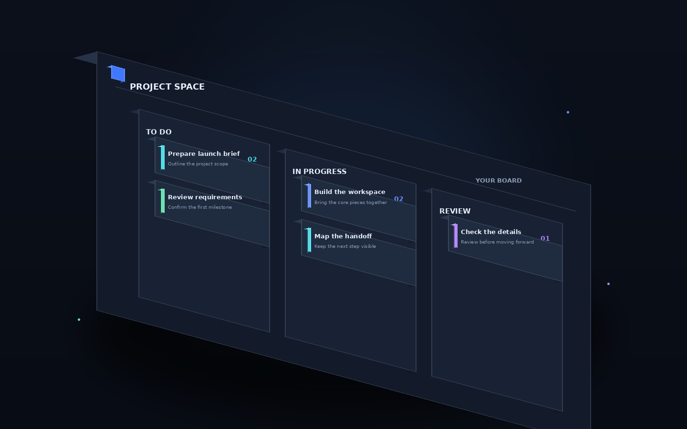
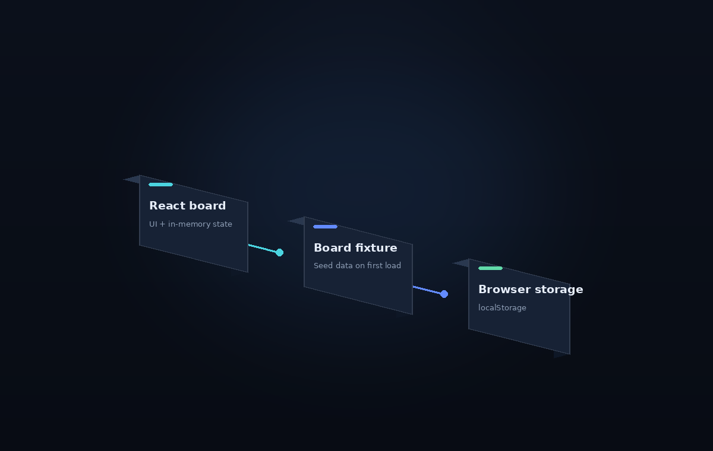
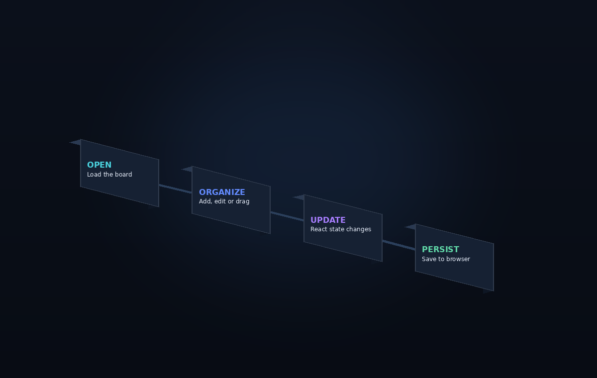
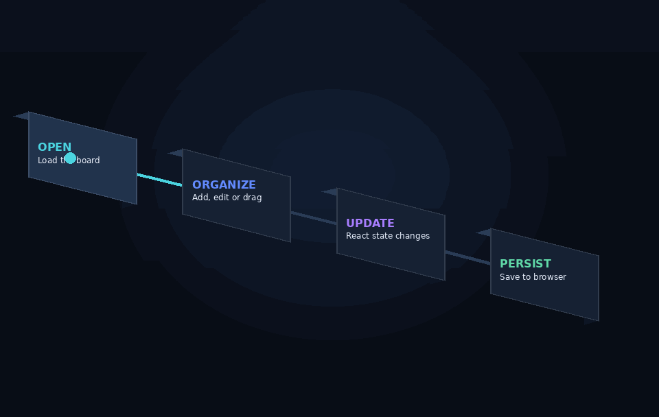
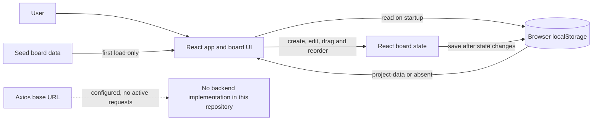
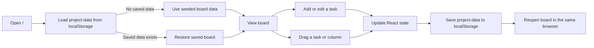

<div align="center">

# Project Management Tool

**A visual Kanban board for keeping small tasks moving.**

This React application organizes tasks into draggable columns, supports quick edits, and saves board changes in the browser.

<p>
  
  
  
  
</p>



*A custom 3D illustration of the board concept—not a screenshot of the running application.*

</div>

## On this page

- [Overview](#overview)
- [Features and implementation status](#features-and-implementation-status)
- [Product visuals](#product-visuals)
- [Architecture](#architecture)
- [Board workflow](#board-workflow)
- [Technology stack](#technology-stack)
- [Project structure](#project-structure)
- [Getting started](#getting-started)
- [Tests and build](#tests-and-build)
- [Limitations](#limitations)
- [Contributing and licensing](#contributing-and-licensing)

## Overview

The home page presents a task board with **To do**, **In progress**, and **Review** columns. Users can create and edit task cards, move tasks between columns, reorder tasks, and rearrange columns. Board state is stored in browser `localStorage`, so it is available again in the same browser profile.

The repository is a client-side React application. It does **not** contain a Django backend or database implementation. Login and signup routes render forms, but authentication requests and token handling are commented out; those screens do not provide working authentication.

## Features and implementation status

| Feature | What the code does | Status |
|---|---|---|
| Kanban board | Renders the board from three columns and seeded task data. | Implemented |
| Create tasks | Adds a title and description to the selected column. | Implemented |
| Edit tasks | Opens an editor for a task title and description. | Implemented |
| Move and reorder tasks | Supports drag-and-drop within a column and between columns. | Implemented |
| Reorder columns | Supports horizontal drag-and-drop of columns. | Implemented |
| Browser persistence | Loads and saves board state using `localStorage` under `project-data`. | Implemented |
| Login and signup | Routes render form UIs; submit handlers and authentication are not wired up. | UI only |
| Backend and database | No backend or database implementation is included. | Not implemented |
| Responsive layout | No responsive behavior has been verified. | Unverified |

These statuses describe what is present in the source; automated tests are not included.

## Product visuals

The visuals below are original 3D-rendered illustrations made for this README. They communicate the implemented client-side board and its data flow; **they are not captured product screenshots**.

### 3D board concept

<div align="center">

</div>

### 3D architecture

<div align="center">

</div>

### 3D workflow

<div align="center">

</div>

<p align="center">
  
</p>

### Application screenshots

The following original screenshots are hosted by the upstream project and shown here with attribution. They depict its login screen, task board, and task editor.

| Login screen | Project board |
|---|---|
|  |  |

| Task editor |
|---|
|  |

Screenshots are from [swarina/YouShd-Todo](https://github.com/swarina/YouShd-Todo#screenshots); they illustrate the upstream application and are not newly captured images of this checkout.

## Architecture

The active board is a client-side React experience. Its working data path is browser storage—not the configured Axios URL.



The login and signup pages are separate UI routes. The login request and token-related code are commented out, so there is no implemented authentication flow to diagram.

### 3D architecture illustration

The rendered architecture image above shows the board UI, its starter data, and browser storage as separate depth layers. The Axios endpoint is intentionally not drawn as a live service because the application does not currently make requests to it.

## Board workflow



The workflow animation above highlights the stages of this client-side flow. The illustration does not imply server synchronization or authentication.

## Technology stack

| Layer | Technology | Purpose |
|---|---|---|
| UI | React 17 | Component-based application interface |
| Routing | React Router 6 | `/`, `/login`, and `/signup` routes |
| Drag and drop | `react-beautiful-dnd` 13 | Reordering columns and moving tasks |
| HTTP client | Axios 0.27 | Configured base URL; active API requests are not wired up |
| Persistence | Browser `localStorage` | Stores the board as `project-data` |
| Build and development | Create React App / `react-scripts` 5 | Local development server, production build, and test runner |
| Icons | `react-icons` 4 | Sidebar and header icons |

## Application components

| Component or module | Responsibility | Implementation |
|---|---|---|
| App | Selects the home, login, and signup routes. | [`src/App.js`](src/App.js) |
| Projects page | Composes the sidebar, header, and task board. | [`src/pages/Projects/`](src/pages/Projects/) |
| DragNDrop | Owns board state, drag operations, task creation/editing, and local persistence. | [`src/components/Projects/DragNDrop/`](src/components/Projects/DragNDrop/) |
| Column | Renders a draggable column and its task-creation form. | [`src/components/Projects/Column/`](src/components/Projects/Column/) |
| Task | Renders an individual draggable task card. | [`src/components/Projects/Task/`](src/components/Projects/Task/) |
| Edit | Edits a task title and description. | [`src/components/Projects/Edit/`](src/components/Projects/Edit/) |
| Seed data | Defines the initial tasks, columns, and column order. | [`src/data.js`](src/data.js) |
| Axios configuration | Defines a base URL; it is not evidence of a working backend. | [`src/api/axios.js`](src/api/axios.js) |

## Project structure

| Directory or file | Responsibility |
|---|---|
| `public/` | Static HTML entry point |
| `src/pages/` | Projects, login, and signup page views |
| `src/components/` | Header, sidebar, task board, columns, and task cards |
| `src/api/` | Axios client configuration |
| `src/assets/images/` | Images referenced by the UI |
| `src/data.js` | Initial board fixture |
| `assets/readme/` | README illustrations and the script that renders them |
| `package.json` | Dependencies and npm scripts |

## Getting started

### Requirements

| Requirement | Version or configuration | Notes |
|---|---|---|
| Node.js | Installed | Used by Create React App; no version is pinned in `package.json`. |
| npm | Installed | Install the dependencies declared in `package-lock.json`. |
| Browser | Modern browser with `localStorage` | Board data stays in that browser profile. |
| Python and Pillow | Optional | Only needed to regenerate the README illustrations. |

### Install and run

```bash
git clone https://github.com/channallikrishnasai/project-management-tool.git
cd project-management-tool
npm ci
npm start
```

Open [http://localhost:3000](http://localhost:3000). The board is available at `/`; `/login` and `/signup` show UI-only forms.

### Environment configuration

No environment variables are required to run the client-side board locally. The Axios configuration contains a fixed legacy URL, but active requests to that URL are not implemented. Do not add credentials or secrets to the repository.

## Tests and build

Run a production build with:

```bash
npm run build
```

Run the test runner with:

```bash
npm test
```

No test files are currently present, so there are no application tests to report as passing.

To regenerate the README illustrations, install Pillow in your Python environment and run:

```bash
python3 assets/readme/render_3d.py
```

The script renders static PNGs and a short GIF from custom 3D geometry. The animation is an actual sequence of rendered frames, not a CSS or SVG animation.

## Known limitations

- Login and signup are presentation-only; authentication and token handling are commented out.
- There is no bundled backend, database, or active API integration.
- The board uses browser-local persistence and does not synchronize between devices.
- Task deletion, priority, due dates, and project creation are not implemented.
- No automated tests or responsive-layout verification are present.
- The source repository does not specify a license. Do not redistribute this checkout until reuse terms are clarified.

## Contributing and licensing

The upstream repository does not specify a license; permission to republish its source was confirmed by the requester. README illustrations in `assets/readme/` are original project documentation assets.

## Credits

The application source inspected for this project comes from [swarina/YouShd-Todo](https://github.com/swarina/YouShd-Todo). The original README describes a React task board with a Django service, but this checkout contains only the React application; it does not include Django source.
